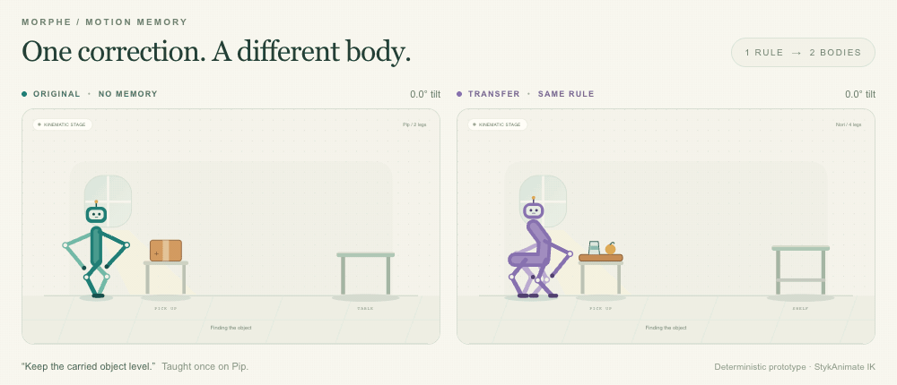
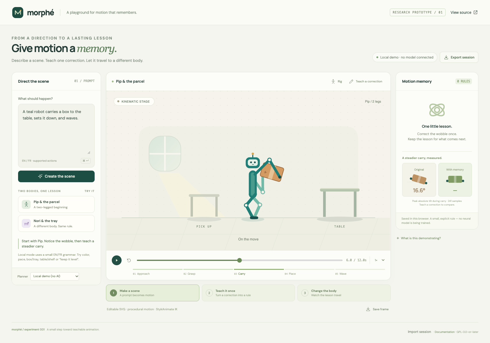
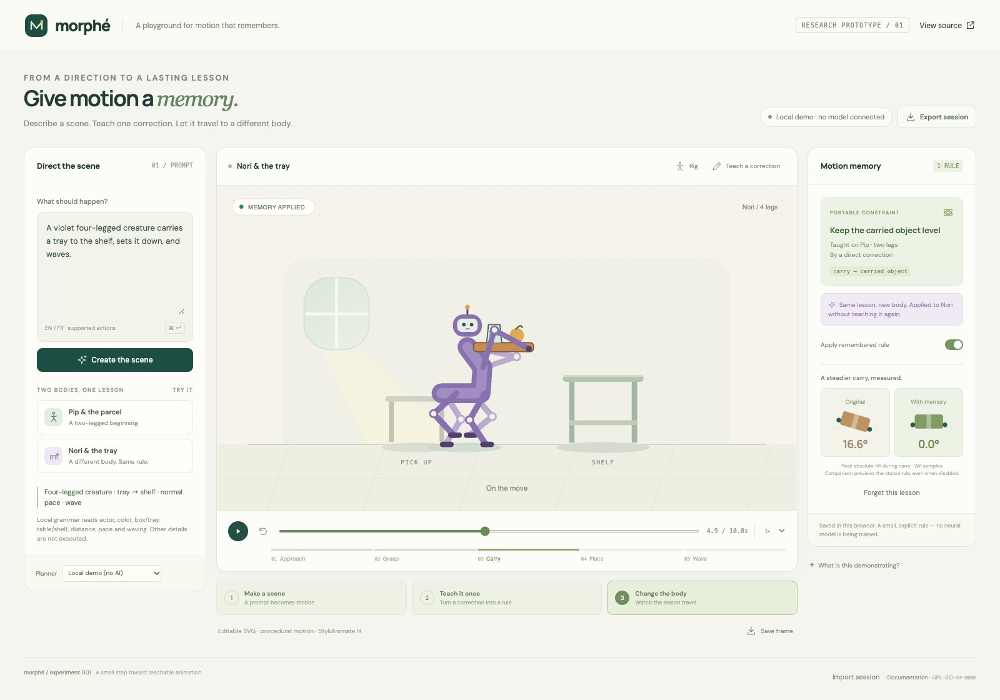
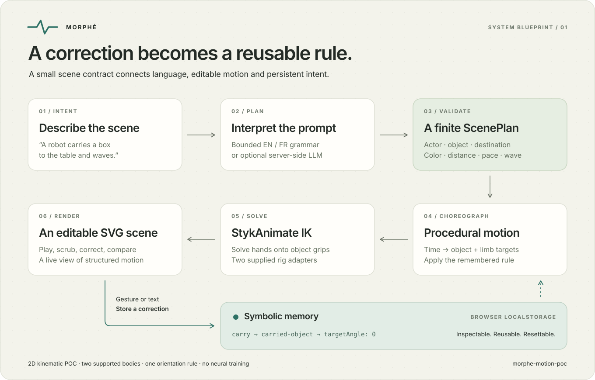

<div align="center">

# Morphé

**Direct a scene. Teach a correction. Try another body.**

A small, inspectable experiment in motion authoring with reusable intent.

[Open the playground](https://nicolashedoire.github.io/morphe-motion-poc/) · [How it works](#how-it-works) · [Research & next steps](docs/RESEARCH.md)

</div>



*Left: Pip's baseline carry. Right: the remembered level-carrying rule on Nori, a second supported body. Both views render the actual procedural engine.*

Morphé turns a short instruction into a 2D carrying scene. You can adjust the carried object's orientation, save that correction, and apply the same rule to a second body. The animation stays editable: the character, object, destination, speed and waving are explicit scene data.

The experiment is deliberately small. Its central question is whether **one correction can become useful intent that survives a change of character**, instead of becoming another pose to redo.

## Try the complete story



1. **Direct.** Start with `A teal robot carries a box to the table, sets it down, and waves.` The character approaches, picks up the box, carries it, places it, and waves.
2. **Teach.** Choose **Teach a correction**. Drag the orange handle against the horizontal reference guide, then choose **Remember correction**. **Level it** is an accessible alternative to dragging; `Keep the object horizontal` also creates and saves a level-carrying rule.
3. **Transfer.** Try `A violet four-legged creature carries a tray to the shelf, sets it down, and waves.` The stored rule targets the carried object, so it can apply to this second supported rig.
4. **Compare.** Toggle memory to compare the baseline motion with the corrected version. Refresh to check that the rule persists in this browser.



The baseline's wobble is authored into the demonstration to make the correction visible. Removing it is a deterministic constraint operation. No neural network is trained when you click **Remember correction**.

## What runs today

| Capability | Implemented scope |
| --- | --- |
| Scene direction | Bounded English/French grammar; optional language-model planning on a local server |
| Characters | One biped robot or one stylized four-legged creature with two carrying arms |
| Objects and destinations | A box or tray; a table or shelf; near or far |
| Animation | Approach → grasp → carry → place → optional wave |
| Appearance and timing | Teal, blue, coral/red or violet; slow, normal or fast |
| Correction memory | One explicit carried-object orientation rule, stored in browser `localStorage` |
| Transfer | The same rule applied through two hand-authored rig adapters |
| Rendering | Procedural 2D motion, StykAnimate inverse kinematics, live SVG |
| Sharing | Export/import a scene-and-memory JSON session; save the current SVG frame |

Try small edits such as `Make it slower`, `Rapproche la table`, `Personnage violet`, or `No wave`. The local parser preserves unspecified scene fields, handles supported wave negations, and rejects known unsupported actions. It displays a warning when it uses its limited vocabulary: unrecognized details are not executed.

This POC does not generate arbitrary actions, realistic physics, multiple interacting actors or arbitrary imported skeletons. It uses 2D kinematics without a full collision or dynamics solver. It contains no trained motion model, motion-capture dataset, 3D model generation or video synthesis.

## Run locally

Use **Node.js 24 or later**.

```bash
git clone https://github.com/nicolashedoire/morphe-motion-poc.git
cd morphe-motion-poc
npm install
npm run dev
```

Open the local address printed by Vite, normally `http://127.0.0.1:5173`. The default planner works without an API key, account or model download. The public GitHub Pages demo uses this same local grammar.

```bash
npm run build         # Type-check and build the static app
npm run preview       # Serve the build on 127.0.0.1:4173
npm test              # Parser, memory, kinematics and mocked API checks
npm run test:browser  # Browser checks; starts its own preview of the existing build
```

If Playwright has no browser installed, run `npx playwright install chromium` before the browser checks.

To reproduce the documentation media after building:

```bash
UPDATE_SCREENSHOTS=1 npm run test:browser  # Refresh the two studio screenshots
node scripts/render-preview.mjs          # Render the synchronized motion GIF
```

The GIF script requires `ffmpeg` and either Google Chrome on macOS or Playwright Chromium. `FFMPEG_PATH` and `CHROME_EXECUTABLE` can override executable locations. It renders 60 frames from the same motion engine and SVG renderer used by the app, then encodes a six-second preview. These tools are only needed to regenerate the GIF, not to run Morphé.

## Optional language-model planner

The local Vite development and preview servers can call the OpenAI Responses API. This replaces the text-to-plan step; the procedural motion engine and the permitted scene vocabulary stay the same.

```bash
cp .env.example .env
```

Set server-only values in `.env`, then restart Vite:

```dotenv
OPENAI_API_KEY=your_key_here
OPENAI_MODEL=gpt-4.1-mini
```

The interface reports whether the provider is available. Choose **OpenAI** in the planner selector to use it. Provider requests send the prompt and current scene to OpenAI and may incur API charges. Keys stay on the local server: never prefix them with `VITE_`, include them in scene files, or commit `.env`.

`GET /api/status` reports availability. `POST /api/plan` accepts `{ "prompt": "…", "currentScene": { … } }` and returns a validated scene, correction or unsupported result. Requests use a fixed upstream endpoint, a strict structured-output schema, a request-size limit, a timeout and a same-origin check. Failed provider requests surface an error rather than silently becoming a local answer. Static GitHub Pages has no server-side AI endpoint.

**Validation status:** the provider integration is covered by mocked tests for valid plans, refusals, invalid output, unavailable configuration, timeouts and concurrency. Live inference was not tested during creation because credentials were unavailable.

## How it works



The planner emits a small `ScenePlan`, never executable code. A deterministic motion engine evaluates each frame from time. During carrying, it applies the remembered orientation to the object and computes hand targets on the object's grips. StykAnimate's inverse-kinematics solver positions the limbs, and the renderer draws the result as SVG.

Memory describes **what to preserve**, rather than a list of joint angles. Its relevant fields look like this:

```json
{
  "kind": "orientation",
  "action": "carry",
  "target": "carried-object",
  "targetAngle": 0,
  "taughtOn": "biped",
  "source": "gesture"
}
```

This is an excerpt; the persisted rule also includes an ID, version, tolerance and timestamp. Angles use radians. The demonstration stores one rule, and a new correction replaces it. “Transfer” here means that both supplied rig adapters know how to carry the same constrained object. It does not establish generalization to unseen anatomy or real robots.

| File | Responsibility |
| --- | --- |
| [`src/domain.ts`](src/domain.ts) | Scene, rule and frame contracts |
| [`src/planner.ts`](src/planner.ts) | Bilingual local grammar and strict result validation |
| [`server/planner.mjs`](server/planner.mjs) | Optional OpenAI planning endpoint |
| [`src/memory.ts`](src/memory.ts) | Validate, persist and forget a symbolic rule |
| [`src/motion.ts`](src/motion.ts) | Choreography, rig targets and measured motion values |
| [`src/vendor/styk-ik.mjs`](src/vendor/styk-ik.mjs) | Attributed StykAnimate point solver |

## What would make this a product?

The next useful milestone is a comparison with existing animation tools: can creators complete a second scene faster because the first correction survives? A stronger version would support multiple scoped rules, conflict resolution, additional rig adapters, animation-tool interchange, and an existing learned motion generator behind the same editable scene contract.

Text-to-motion, constraint-guided generation and interactive motion control already have substantial prior work. This repository demonstrates a workflow hypothesis, not a claim of a unique invention. The [research notes](docs/RESEARCH.md) explain the relevant work, the distinction between implemented behavior and ambition, and a concrete evaluation plan.

## Credits and license

Morphé includes `ikBendReference` and `solveIKPoints` from [StykAnimate-App](https://github.com/filippocalippo/StykAnimate-App), by Filippo Calippo and contributors, pinned to commit [`def9721`](https://github.com/filippocalippo/StykAnimate-App/tree/def97214c2b491fbce82647f625a73f78416c6d8). Their function bodies are retained without changes; the extraction adds local helpers and provenance metadata. Morphé uses this point solver, not the full StykAnimate application.

The project is distributed under **GPL-3.0-or-later**. See [`LICENSE`](LICENSE) and [`NOTICE`](NOTICE) for the exact attribution and extraction boundary. StykAnimate is not affiliated with or an endorser of this demonstration. The documentation diagram is original artwork; the screenshots show the running POC.
